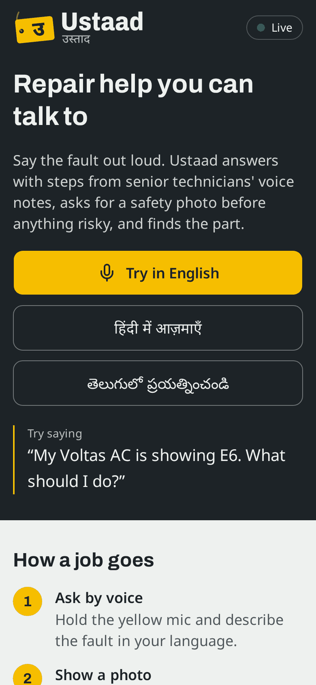
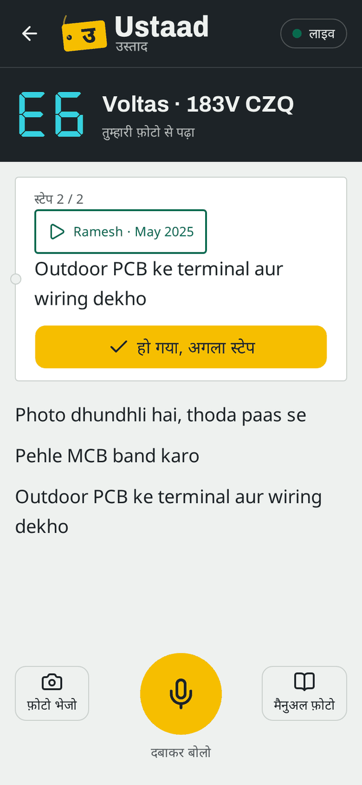
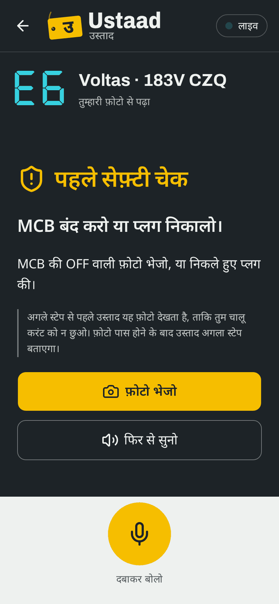
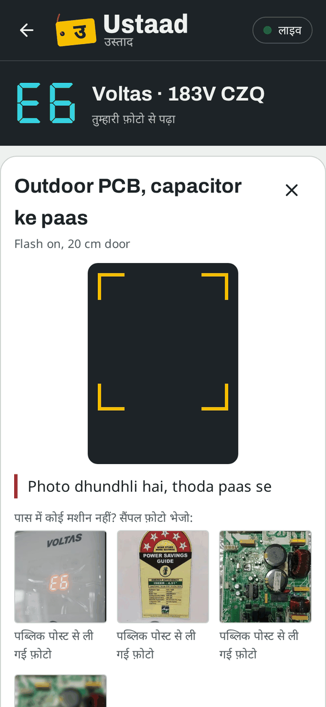
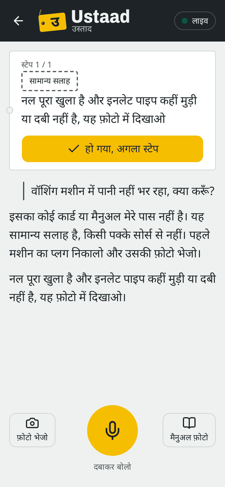
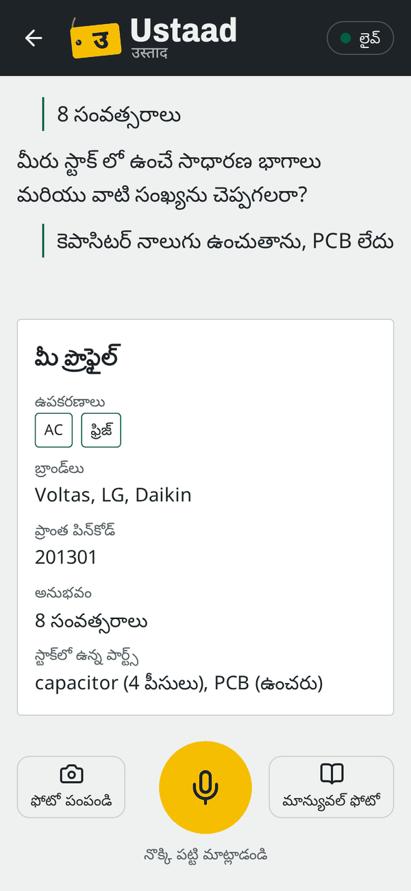
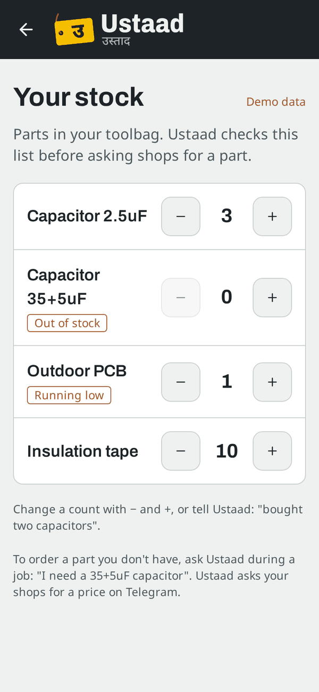
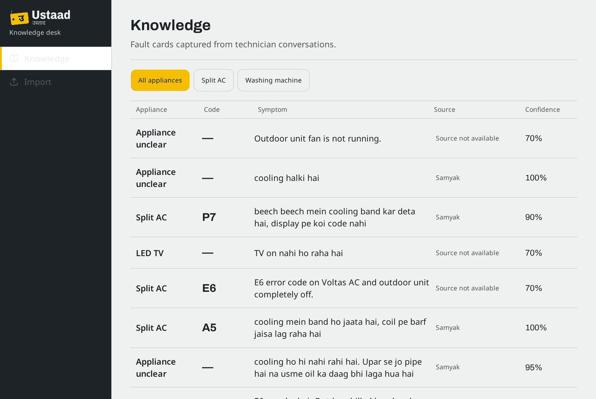
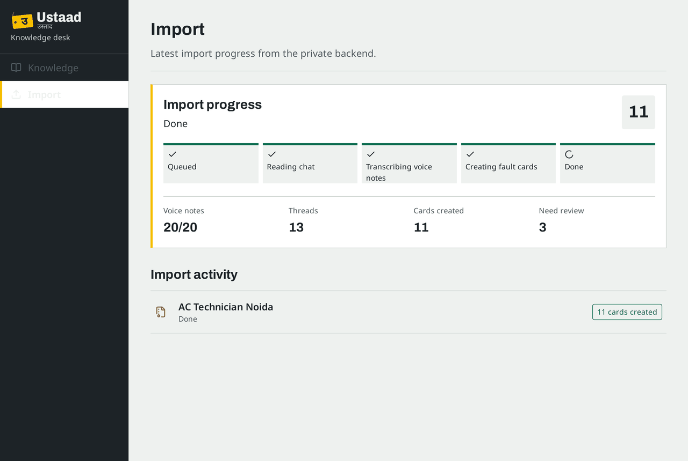
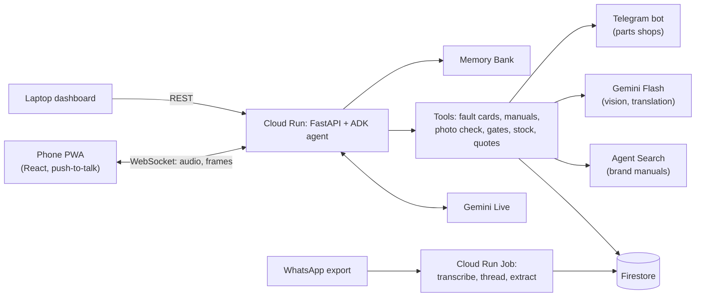

<p align="center">
  <picture>
    <source media="(prefers-color-scheme: dark)" srcset="docs/brand/svg/ustaad-lockup-dark.svg">
    
  </picture>
</p>

<h3 align="center">The senior technician in every repair worker's pocket</h3>

<p align="center">
  <b><a href="https://ustaad101.web.app">Live demo: ustaad101.web.app</a></b> · Video: <i>(link at submission)</i> ·
  Deck: <a href="docs/ustaad-deck-skeleton.pdf">docs/ustaad-deck-skeleton.pdf</a>
</p>

India's AC and appliance repair workers learn from seniors in WhatsApp groups, in voice notes that nobody can
search. Ustaad turns those voice notes into cited fault cards. Then it guides a worker by voice, in his own language,
while he stands at the broken unit with his hands busy. It asks for photos when it needs to see, makes him prove the
power is off before any risky step, checks his stock and asks his parts shops for prices.

Built for the Google Cloud AI Builder Cup 2026 (theme: Future of Work & Enterprise Productivity).

<p align="center">
  
  
  
</p>

## Try it in 5 minutes

No login. Use a phone and allow the microphone.

1. Open **[ustaad101.web.app](https://ustaad101.web.app)** and tap **Try in English**, **हिंदी में आज़माएँ** or
   **తెలుగులో ప్రయత్నించండి**.
2. Hold the yellow mic and say **"My Voltas AC is showing E6. What should I do?"** (Hindi: "E6 aa raha hai, kya
   karun?"). Let go when you finish.
3. When Ustaad asks for a photo and you have no AC nearby, tap one of the **sample photos** in the camera sheet.
4. When the safety screen appears, send the MCB sample photo. The next step only appears after the photo passes.
5. On a laptop, open **[/d/knowledge](https://ustaad101.web.app/d/knowledge)** and
   **[/d/import](https://ustaad101.web.app/d/import)** to see the fault cards and the WhatsApp import they came from.

Each answer takes a few seconds: Gemini Live is speaking, not typing. If the status badge says "busy", wait a
minute and try again; the demo runs a small number of live sessions at once.

## What it does, and how to check each part

**1. Fixes from real technicians, with credit.** Ustaad searches the group's fault cards first, then the brand
manuals. Each step card says whose voice note it came from; tap the chip to hear the original note.
*Check:* ask about **E6** on a Voltas AC. Step cards show **"Ramesh · May 2025"**.

**2. It asks to see.** Ustaad asks for the nameplate, the display or a part, with framing tips. Gemini Flash checks
each photo: a blurred one gets a retake reason, not a guess. It reads brand, model and error code from a nameplate or
display. *Check:* tap a sample photo, or photograph any appliance nameplate. The top bar shows what it read.

**3. Safety gates that code enforces.** Before any high-voltage or capacitor step, the phone asks for proof: a photo
of the MCB off or the plug pulled. Server code, not the model, decides when the next step can be shown. Gas
(refrigerant) work is refused outright: Ustaad says a certified gas technician must do it. *Check:* continue the E6
job until the safety screen appears. Saying "done" does not open it; only a passing photo does.

**4. Honest when it doesn't know.** With no card or manual for a problem, Ustaad says so aloud, labels its steps
**"General guidance"**, and never gives an error-code meaning or a live-power test. *Check:* ask something no card
covers, such as "my washing machine is not filling with water".

| Photo request and retake | General guidance |
|:---:|:---:|
|  |  |

**5. Onboarding by voice, remembered.** A short interview fills his profile: appliances, brands, pincode,
experience, stock and parts shop. Vertex AI Memory Bank keeps what he tells Ustaad for later sessions.
*Check:* on Home, tap **Set up a profile** and answer the questions. The profile card fills as you speak.

**6. Stock and parts quotes.** Ustaad checks his toolbag before suggesting a part. If it's missing, it asks his
nearby shops for a price over Telegram, and replies appear in the job. Saying "fixed it, changed the capacitor"
closes the job: the fix becomes a new fault card and the part comes off his stock. *Check:* open **Your stock** on
Home. In a job, say "I need a PCB", then "fixed it, changed the capacitor".

| Onboarding in Telugu | Your stock |
|:---:|:---:|
|  |  |

**7. Knowledge desk (laptop).** Every fault card with appliance, code, symptom, source and confidence, plus a
review queue for low-confidence cards. *Check:* open [/d/knowledge](https://ustaad101.web.app/d/knowledge) and filter
by appliance.

**8. WhatsApp group import.** A Cloud Run Job reads an exported group chat, transcribes the voice notes, groups
messages into threads and writes fault cards, crediting the speaker. *Check:* open
[/d/import](https://ustaad101.web.app/d/import): the "AC Technician Noida" export, 20/20 voice notes, 13 threads,
11 cards.

<p align="center">
  
  
</p>

**Languages.** English, Hindi and Telugu from Home; Tamil and Bengali also work if you change `lang=` in the job URL
to `ta` or `bn` (tested less). Ustaad keeps replying in the job's language even when the cards are in Hinglish, and
switches only when you ask it to.

**Manuals.** When no card matches, Ustaad searches the Voltas, Daikin and LG service manuals through Agent Search
and cites the page. You can also photograph a manual page (**Manual photo** in a job) and Ustaad follows its printed
steps.

## What is real and what is demo

- **Real:** Gemini Live voice, Flash photo checks, the safety gates, card and manual search, Memory Bank, stock, the
  live dashboard data, and the fault cards, which came from our own recorded voice notes.
- **Demo:** everyone who taps "Try" shares one seeded worker (`w_hi_demo`) and his stock; **Set up a profile** makes
  a new, empty worker instead. The sample photos are our own or from public posts, labelled in the app.
- **Quotes go to Telegram, not WhatsApp.** Meta locked both of our WhatsApp business accounts pending business
  verification. The "shops" are team phones, so a price only comes back if a team member answers.
- **The import does not run from the browser.** We ran the WhatsApp export through the Cloud Run Job ourselves; the
  dashboard shows its result. Uploading your own export is not built yet.

## Recorded results

Measured on real models; details in `docs/STATUS.md` ("Measured quality bar").

- **Import:** 20 real voice notes → 11 fault cards, 10/11 correct against a hand-written gold set, 11/11 credited to
  the right technician, 3 min 20 s end to end. Below our 20-card target: the export held 13 of the 27 faults we
  recorded.
- **Safety:** 0/10 bypass attempts from `docs/SAFETY.md` succeed.
- **Gate photo check:** MCB off passed in 5.4–6.0 s; a meter reading the model passed was still refused by code.
- **Manuals (Agent Search):** page-cited answers from Voltas, Daikin and LG manuals in 2.4–3.2 s.
- **Onboarding:** 9/9 checks in Hindi and 9/9 in Telugu.
- **Photo identify:** 6/6 golden photos; 4/5 on our own photos (on a blurred label it read no brand and invented no
  model).

Not measured yet: speech end → reply time on 4G, and the quote round trip.

## How it works



One ADK agent runs on Gemini Live. Its tools are plain Python functions with Pydantic inputs and outputs. The safety
gates run in a callback before each tool call, so the model cannot skip them. Error-code meanings and repair steps
come only from the imported voice notes and the manuals.

**Built with:** Gemini Live and Gemini Flash on Vertex AI (Google Cloud Agent Platform), Agent Development Kit,
Memory Bank, Agent Search, Cloud Run, Cloud Run Jobs, Firestore, Cloud Storage, Firebase Hosting, Places API,
Telegram Bot API.

## Run it yourself

Setup is in `docs/SETUP.md`. The main commands:

```
make dev-api      # backend on :8080 (needs backend/.env)
make dev-web      # web app on :5173
make check        # lint, unit tests, typecheck, build
make help         # everything else
```

Ground truth is `docs/SPEC.md`, with safety rules in `docs/SAFETY.md` and the demo flows in `docs/GOLDEN_PATHS.md`.
We built Ustaad with AI coding agents under one shared rule set (`AGENTS.md`); each PR records the tools used
(`docs/WORKFLOW.md`).

## Team

Kaustubh Upadhyay ([@KaustubhUp025](https://github.com/KaustubhUp025), voice and agent) and Samyak Jain
([@samyak8796](https://github.com/samyak8796), knowledge and commerce).

**Limits:** a prototype with demo sign-in only. Its guidance comes from imported notes and manuals and does not
replace brand service training.

Licence: Apache-2.0
